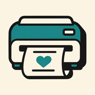
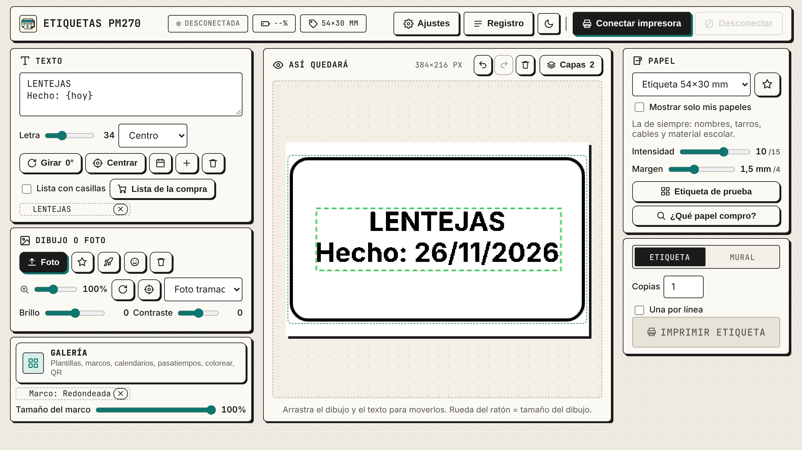
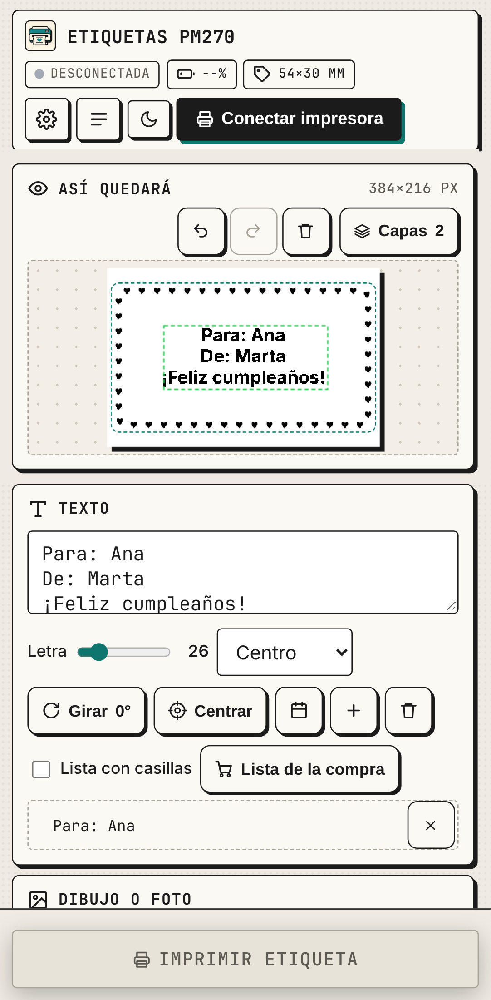
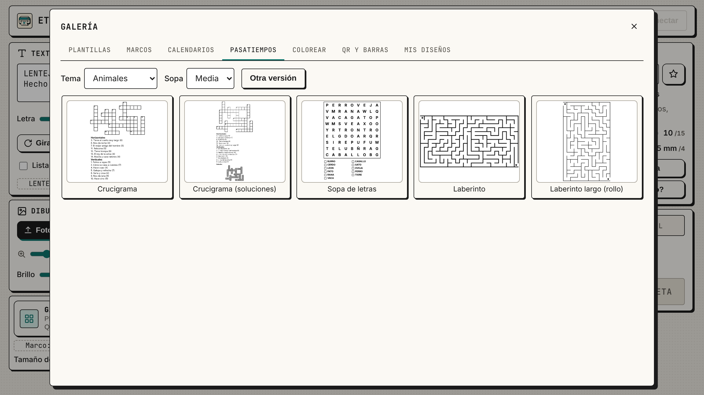
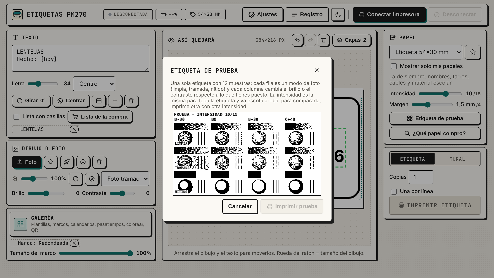

  

<h1 align="center">Etiquetas PM270</h1>

<b>Design and print labels, lists, photos, calendars and puzzles on the Nelko PM270 thermal printer, from your PC or an Android phone.</b> 
Free, no ads, no accounts, and your data never leaves your device.

  <a href="../../releases/latest">Download the Android app (APK)</a> ·
  <a href="https://alialabdev.github.io/etiquetas-termica-pm270/">Open the web version</a> ·
  <a href="README.md">Español</a>

  

<table>
  <tr>
    <td align="center" width="25%"> On your phone</td>
    <td align="center"> Gallery: templates, frames, puzzles, colouring, QR…  
     Test label to tune photos without wasting paper</td>
  </tr>
</table>

> **Independent project.** This app is not made, affiliated, sponsored or endorsed by Nelko. "Nelko" and "PM270" are mentioned only to say which printer it works with. It contains no logos, code or files from the official app: the printer protocol was written from scratch by testing with a printer of my own.
>
> The app interface is in Spanish for now. An English version is on the way.

## A person with ideas, and an AI that helps

Behind ALIALAB there is one person with ideas and curiosity, not a team of developers. My technical skills only go so far, and so does my free time. This project exists because I built it with the help of artificial intelligence ([Claude](https://claude.ai), by Anthropic): I bring the idea, the decisions, the testing on a real printer and the care for details; the AI helps me write and review the code. A few years ago a project like this would have been out of reach for me.

I share it as free software in case it is useful to someone else. If you find a bug or have an idea, please open an issue.

## Features

- **Text, stamps and photos** you can drag and resize (mouse, or pinch on a phone).
- **Photos tuned for thermal paper**: levels, brightness, contrast, sharpness and dithering, plus a **test label** with 12 samples so you can see each setting before wasting paper.
- **Paper types**: labels of several sizes, round labels and continuous roll. Rolls with a chip are detected automatically. **My papers** remembers the ones you own.
- **Checklists** (`# Title`, one line per item, `x` in front to tick it) and **rotated text** 90°/180°/270°.
- **Automatic dates**: `{hoy}` (today), `{hoy+7}`, `{dia}`, `{mes}`, `{año}`, `{hora}`.
- **Gallery**: templates (jar, freezer, expiry, gift, medication, Wi-Fi…), 26 resizable frames, calendars, puzzles (crosswords, word searches, mazes), colouring pages, **QR codes** and **barcodes** (Code 128, EAN-13), and **My designs**.
- **Mural**: splits a large picture into numbered labels that you stick together.
- **Multiple copies** (1–99), with a paper and lid check before printing so you don't waste labels.
- **"Which paper should I buy?"** guide: **phenol-free thermal paper (BPA and BPS free)**.

## How to use it

### On your phone (Android)

1. Download the **APK** from the [latest release](../../releases/latest) on your phone and open it. Android will ask you to allow installing apps from that source.
2. Pair the PM270 in your phone's **Settings → Bluetooth**.
3. In the app, tap **Conectar impresora** (Connect printer) and choose it. Next time it connects by itself.

The APK contains the same app as the web version and works offline. The only permission it asks for is **nearby Bluetooth devices**. New versions install over the old one and keep your designs. There is no iPhone version: iOS does not allow talking to this printer from a web app.

### On your PC (Windows, Chrome or Edge)

1. Pair the PM270 in **Settings → Bluetooth & devices**. Windows assigns it a serial (COM) port.
2. Open the [web version](https://alialabdev.github.io/etiquetas-termica-pm270/) in **Google Chrome** or **Microsoft Edge** (Firefox and Safari have no Web Serial).
3. Click **Conectar impresora** and choose the PM270 port ("Standard Serial over Bluetooth link").
4. Optionally click **Instalar app** to get a desktop shortcut that also works offline.

To use it fully offline you can also download the project (**Code → Download ZIP**) and double-click `web/abrir_etiquetas.bat` (needs Python 3): it opens the app at `http://localhost:8000`.

## Security and privacy

Before each release we review the code for security issues and personal data. This is what you can verify in the code yourself:

- **Nothing is sent to the internet.** No server, accounts, ads, analytics or trackers. A Content Security Policy in `web/index.html` blocks the page from connecting anywhere but itself.
- **Your data stays on your device.** Designs, papers and settings are stored in the browser or app storage and are removed when you uninstall. Cloud backup is disabled in the Android app.
- **Minimal permissions.** On Android it only asks for Bluetooth to talk to the printer (on Android 11 and older, the legacy Bluetooth permissions). No location, camera, contacts or internet permission.
- **External links** (Amazon paper search, source code) open in your browser, and only when you tap them.
- **Signed APK, built in the open.** Each APK is built by GitHub Actions from this code, with actions pinned to exact versions, and signed with the ALIALAB key. An APK that does not come from [Releases](../../releases) cannot be installed over the official one.

No review can guarantee 100% that there are no bugs. If you find a security problem, please report it privately as explained in [SECURITY.md](SECURITY.md).

## For developers

| Folder or file | Purpose |
| --- | --- |
| `web/` | The app: plain HTML, CSS and JavaScript with no build step (`app.js`, `creativo.js`, `mural.js`, `i18n.js`) |
| `web/version.js` | Version number, shared by the web, the APK and Releases |
| `android/` | Android app: the web app in its own window with native Bluetooth |
| `.github/workflows/apk.yml` | Builds, signs and publishes the APK to Releases |
| `probe_pc.py` | Optional Bluetooth LE and serial diagnostics (`pip install -r requirements.txt`) |

**Protocol (summary).** 115200 baud. TSPL job: `SIZE`, `GAP` (optional), `DIRECTION 0,0`, `DENSITY`, `CLS`, `PRINT 1`, `BITMAP x,y,48,height,1,<data>`, `ALLEND`. Print width 384 dots (48 mm at 8 dots/mm). Queries: `BATTERY?`, `CONFIG?`, `ESC ! ?` (status) and `ESC ! o` (roll info). Over Bluetooth LE, write to `ff02` and notifications on `ff01`. Worked out by testing with a printer of my own; it may be incomplete or not apply to other models.

## Support the project

The app is free and will stay free. If you find it useful, a star on the repository, or telling others about it, helps a lot.

## License and notices

Copyright (C) 2026 ALIALAB.

This program is free software: you can redistribute it and/or modify it under the terms of the [GNU Affero General Public License version 3](LICENSE) (AGPL-3.0-only). If you distribute a modified version, or offer it to others over a network, you must publish your source code under the same license. Bundled third-party software and its licenses are listed in [THIRD_PARTY_NOTICES.md](THIRD_PARTY_NOTICES.md).

**No warranty.** It is distributed in the hope that it will be useful, but WITHOUT ANY WARRANTY; without even the implied warranty of MERCHANTABILITY or FITNESS FOR A PARTICULAR PURPOSE (see the license). Use it at your own risk: we are not responsible for damage to your printer, wasted paper or any other problem arising from its use.

**Trademarks.** Nelko and PM270 are trademarks of their owner. "QR Code" is a registered trademark of DENSO WAVE INCORPORATED. This project is independent and not affiliated with, sponsored or endorsed by Nelko.

**Credits.** Idea, design, testing and direction: ALIALAB. Code written with the help of Claude (Anthropic).
