

  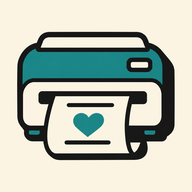

<h1 align="center">Etiquetas PM270</h1>

<b>Diseña e imprime etiquetas, listas, fotos, calendarios y pasatiempos en la impresora térmica Nelko PM270, desde el PC o desde un móvil Android.</b> 
Gratis, sin anuncios, sin cuentas y sin enviar tus datos a ningún sitio.

  
  

  
  

<a href="#cómo-usarla">Cómo usarla</a> · <a href="#qué-puedes-hacer">Qué puedes hacer</a> · <a href="#consejos-y-problemas-frecuentes">Problemas frecuentes</a> · <a href="#seguridad-y-privacidad">Privacidad</a> · <a href="#para-desarrolladores">Desarrolladores</a> · <a href="README.en.md">English</a>

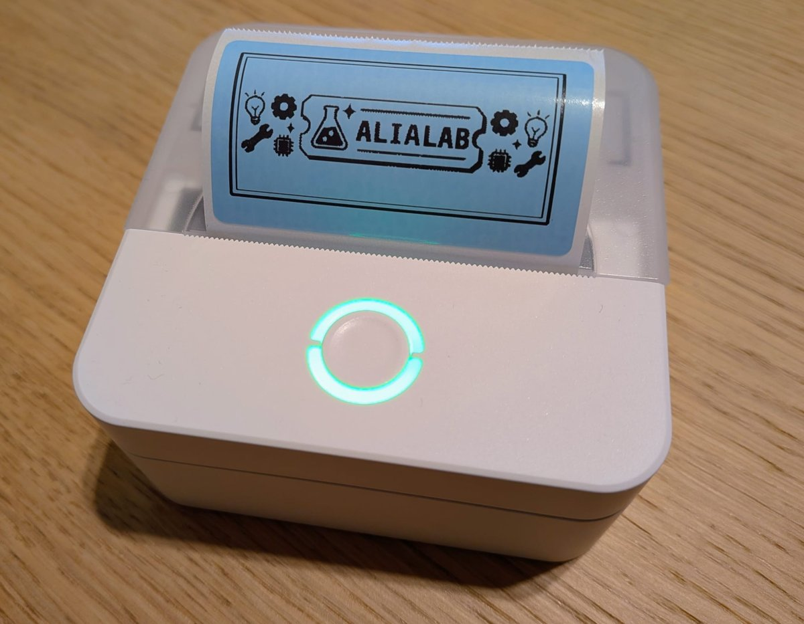

> **Proyecto independiente.** Esta app no está hecha, afiliada, patrocinada ni respaldada por Nelko. «Nelko» y «PM270» se citan solo para indicar con qué impresora funciona. No incluye logos, código ni archivos de la app oficial: la comunicación con la impresora se ha escrito desde cero, probando con una impresora propia.

## Una persona con ideas y una IA que ayuda

Detrás de ALIALAB hay una persona con ideas e inquietudes, no un equipo de programadores. Mis capacidades técnicas llegan hasta donde llegan, y mi tiempo libre también. Este proyecto existe porque lo he desarrollado con la ayuda de la inteligencia artificial ([Claude](https://claude.ai), de Anthropic): yo pongo la idea, las decisiones, las pruebas con la impresora real y el cuidado por los detalles; la IA me ayuda a escribir y revisar el código. Hace unos años un proyecto así habría sido imposible para mí.

Lo comparto como software libre por si a alguien más le sirve. Si encuentras un fallo o tienes una idea, abre una *issue*: la leo con gusto.

## Cómo usarla

### En el móvil (Android)

1. Descarga la **APK** de la [última versión](../../releases/latest) desde el móvil y ábrela. Android pedirá permiso para instalar apps de esa fuente.
2. Empareja la PM270 en **Ajustes → Bluetooth** del móvil.
3. En la app, pulsa **Conectar impresora** y elígela. Las siguientes veces se conecta sola.

La APK lleva dentro la misma app que la web: funciona sin internet. Solo pide el permiso de **dispositivos Bluetooth cercanos**. Las versiones nuevas se instalan encima sin perder tus diseños. No hay versión para iPhone: iOS no permite hablar con esta impresora desde una app web.

### En el PC (Windows, Chrome o Edge)

1. Empareja la PM270 en **Configuración → Bluetooth y dispositivos**. Windows le asigna un puerto serie (COM).
2. Abre la [versión web](https://alialabdev.github.io/etiquetas-termica-pm270/) en **Google Chrome** o **Microsoft Edge** (Firefox y Safari no tienen Web Serial).
3. Pulsa **Conectar impresora** y elige el puerto de la PM270 («puerto serie estándar sobre vínculo Bluetooth»).
4. Si quieres, pulsa **Instalar app** para tener un acceso en el escritorio que funciona también sin internet.

Sin conexión a internet también puedes descargar el proyecto (**Code → Download ZIP**) y hacer doble clic en `web/abrir_etiquetas.bat` (necesita Python 3): abre la app en `http://localhost:8000`.

## Qué puedes hacer

Todo esto sale de la galería de la app con un toque, y luego lo cambias a tu gusto. Estas imágenes son exactamente lo que se imprime.

<table>
  <tr>
    <td align="center" width="33%">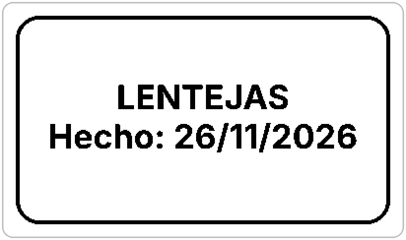 Tarros de cocina con la fecha de hoy</td>
    <td align="center" width="33%">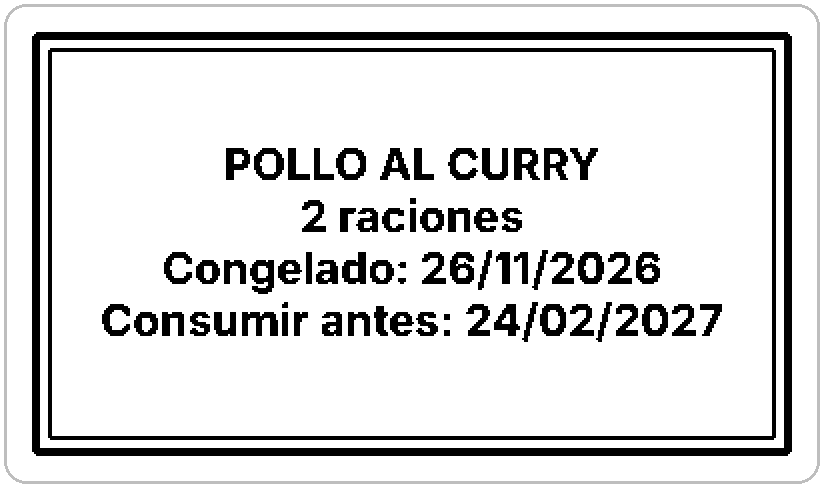 Congelador: raciones y caducidad</td>
    <td align="center" width="33%">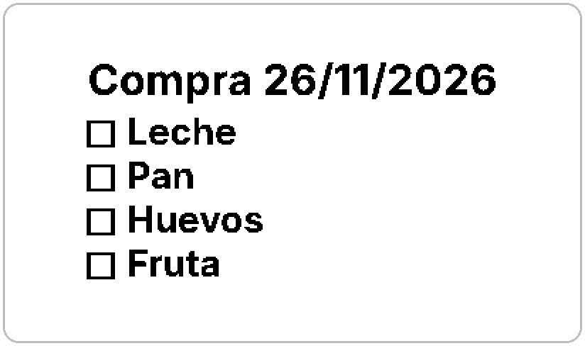 Listas con casillas</td>
  </tr>
  <tr>
    <td align="center" width="33%">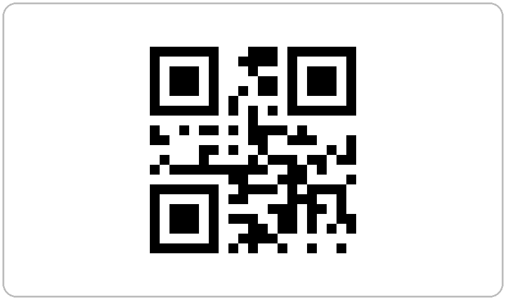 Códigos QR y de barras</td>
    <td align="center" width="33%">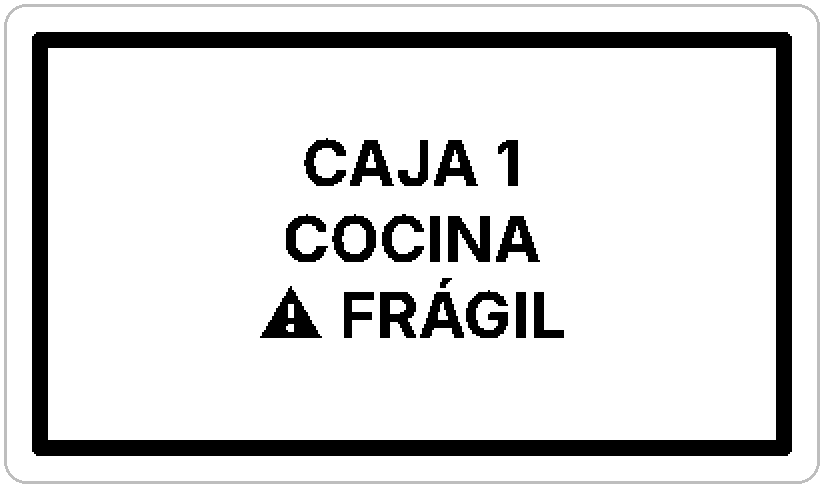 Cajas de mudanza</td>
    <td align="center" width="33%">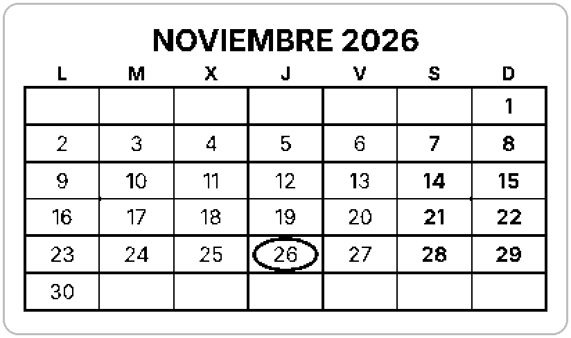 Calendarios del mes</td>
  </tr>
  <tr>
    <td align="center" width="33%">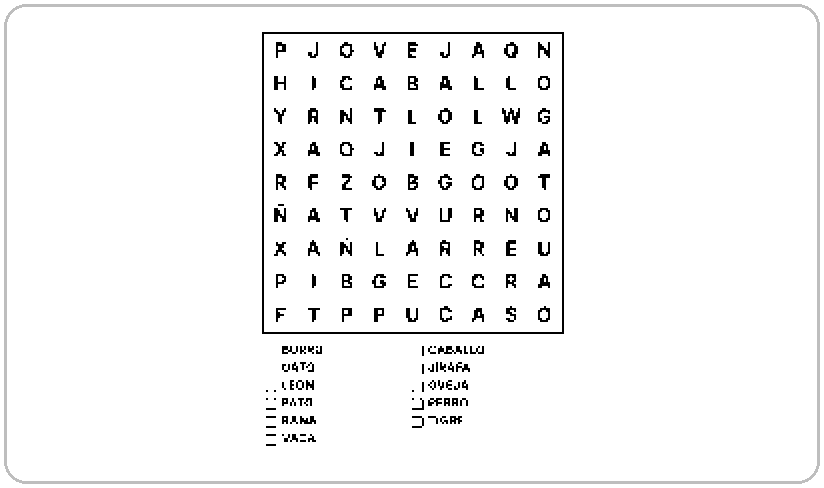 Sopas de letras y crucigramas</td>
    <td align="center" width="33%">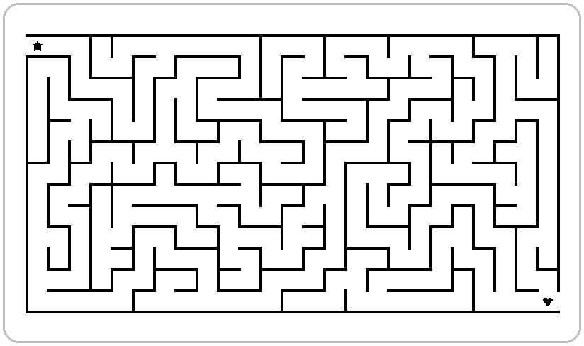 Laberintos</td>
    <td align="center" width="33%">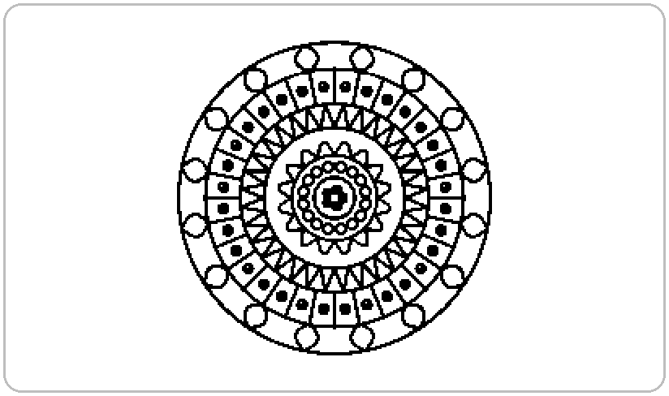 Dibujos para colorear</td>
  </tr>
</table>

<b>Todas las funciones</b>

- **Texto, sellos y fotos** que se arrastran y se amplían (con el ratón o pellizcando en el móvil).
- **Fotos ajustadas para papel térmico**: niveles, brillo, contraste, nitidez y tramado. Incluye una **etiqueta de prueba** con 12 muestras para ver cómo afecta cada ajuste antes de gastar papel.
- **Tipos de papel**: etiquetas de varios tamaños, redondas y rollo continuo. Los rollos con chip se detectan solos. **Mis papeles** guarda los que tienes comprados.
- **Listas con casillas** (`# Título`, una línea por elemento, `x` delante para tacharlo) y **texto girado** 90°/180°/270°.
- **Fechas automáticas**: `{hoy}`, `{hoy+7}`, `{dia}`, `{mes}`, `{año}`, `{hora}`.
- **Galería**: plantillas (tarro, congelador, caducidad, regalo, medicación, Wi-Fi…), 26 marcos con tamaño ajustable, calendarios, pasatiempos (crucigramas, sopas de letras, laberintos), dibujos para colorear, **códigos QR** y **de barras** (Code 128, EAN-13) y **Mis diseños**.
- **Mural**: divide una imagen grande en varias etiquetas numeradas para pegarlas juntas.
- **Varias copias** (1–99) y comprobación de papel y tapa antes de imprimir, para no desperdiciar etiquetas.
- Guía **¿Qué papel compro?**: papel térmico **sin fenoles (libre de BPA y BPS)**.

## Así es la app

<table>
  <tr>
    <td align="center" width="25%">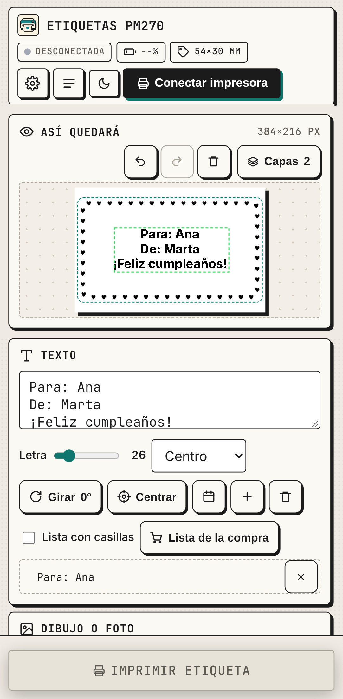 En el móvil</td>
    <td align="center">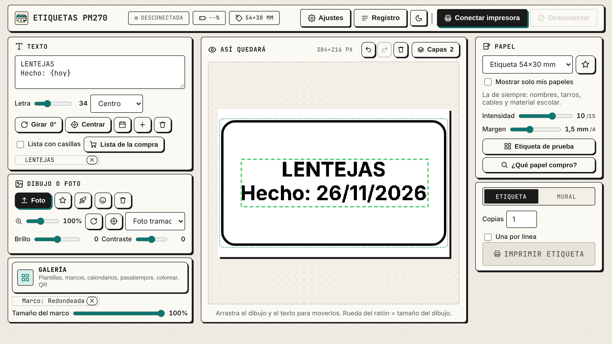 En el PC  
    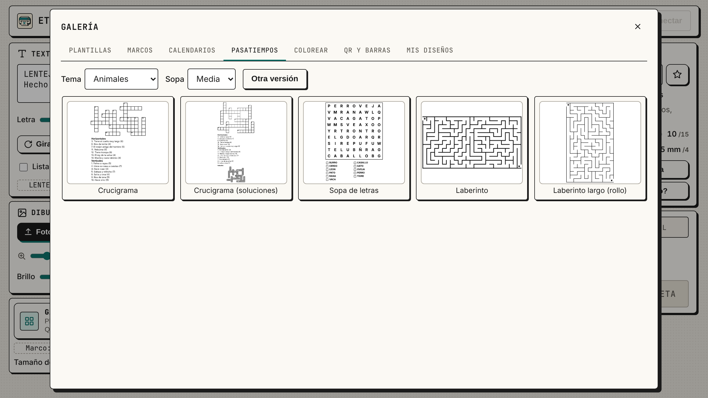 Galería: plantillas, marcos, pasatiempos, colorear, QR…</td>
  </tr>
</table>

## Consejos y problemas frecuentes

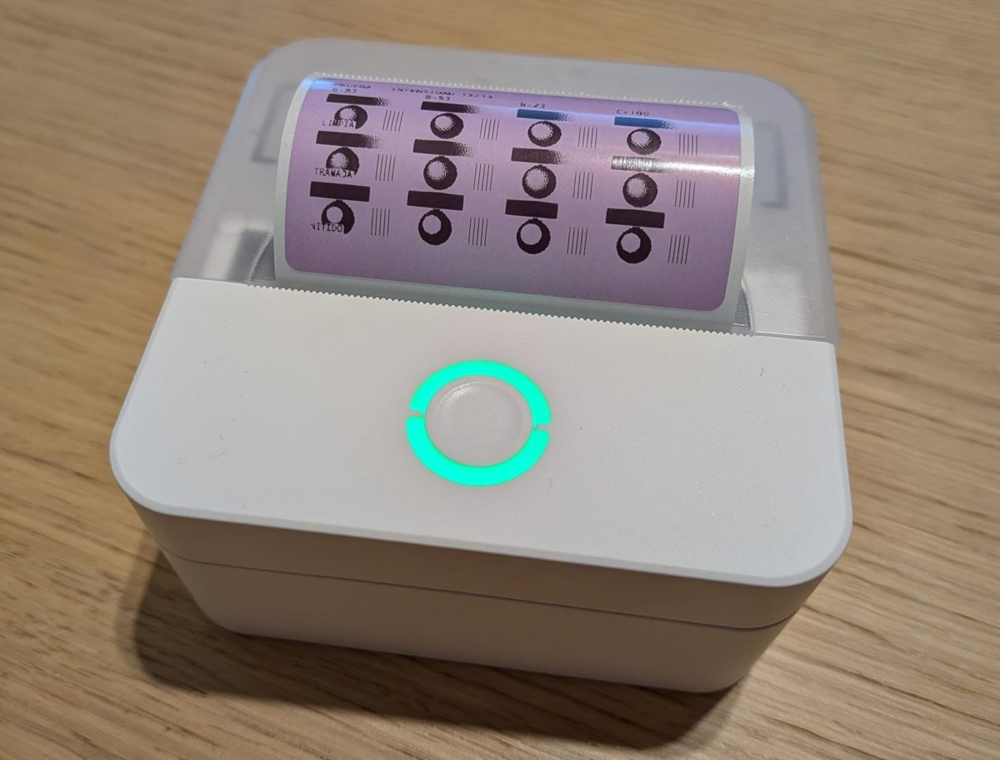

- **No aparece la impresora.** Comprueba que está encendida y emparejada (en el PC, en Configuración → Bluetooth; en el móvil, en Ajustes → Bluetooth). Solo admite una conexión a la vez: desconéctala del móvil, de la app oficial o de otra pestaña antes de conectar.
- **En Android no la encuentra.** Acepta el permiso de **dispositivos cercanos** la primera vez. Si lo denegaste, actívalo en Ajustes → Aplicaciones → Etiquetas PM270 → Permisos.
- **Se ha perdido la conexión.** La app intenta reconectar sola. Si no lo consigue, apaga y enciende la impresora y pulsa **Conectar impresora**.
- **Sale muy clara o muy oscura.** Sube o baja la **Intensidad** en el panel Papel. Para fotos, imprime la **Etiqueta de prueba** (foto de la derecha): en una sola etiqueta ves 12 combinaciones de modo, brillo y contraste y eliges la que mejor queda.
- **Avisa de que no hay papel o la tapa está abierta.** La impresora da el mismo aviso en los dos casos: revisa ambas cosas.
- **Has rellenado el cartucho con otro papel.** Activa en Ajustes «Mi cartucho está rellenado», para que la app no use el tamaño que dice el chip del rollo.
- **Se corta un poco por los lados.** La impresora pierde unos 2 mm en cada borde lateral; deja ese margen en tus diseños.

 

## Seguridad y privacidad

Antes de publicar cada versión revisamos el código buscando problemas de seguridad y datos personales. Esto es lo que puedes comprobar tú mismo en el código:

- **No envía nada a internet.** La app no tiene servidor, cuentas, publicidad, analíticas ni rastreadores. Una política de seguridad de contenidos (CSP) en `web/index.html` impide que la página se conecte a ningún sitio que no sea ella misma.
- **Tus datos se quedan en tu equipo.** Diseños, papeles y ajustes se guardan en el almacenamiento del navegador o de la app, y se borran al desinstalarla. La app Android tiene la copia de seguridad en la nube desactivada.
- **Permisos mínimos.** En Android solo pide Bluetooth para hablar con la impresora (en Android 11 o anterior, los permisos de Bluetooth antiguos). No pide ubicación, cámara, contactos ni internet.
- **Los enlaces externos** (búsqueda de papel en Amazon, código fuente) se abren en tu navegador y solo cuando tú los pulsas.
- **APK firmada y compilada a la vista.** Cada APK se compila en GitHub Actions a partir de este código, con las acciones fijadas por versión exacta, y se firma con la clave de ALIALAB. Si instalas una APK que no viene de [Releases](../../releases), Android no la dejará instalar encima de la oficial.

Ninguna revisión garantiza al 100 % que no haya fallos. Si encuentras un problema de seguridad, cuéntanoslo en privado como se explica en [SECURITY.md](SECURITY.md).

## Para desarrolladores

| Carpeta o archivo | Para qué |
| --- | --- |
| `web/` | La app: HTML, CSS y JavaScript sin dependencias ni compilación (`app.js`, `creativo.js`, `mural.js`, `i18n.js`) |
| `web/version.js` | Número de versión, compartido por la web, la APK y Releases |
| `android/` | App Android: la web dentro de una ventana propia con Bluetooth nativo |
| `.github/workflows/apk.yml` | Compila y firma la APK y la publica en Releases |
| `probe_pc.py` | Diagnóstico opcional por Bluetooth LE y puerto serie (`pip install -r requirements.txt`) |

**Protocolo (resumen).** 115200 baudios. Trabajo TSPL: `SIZE`, `GAP` (opcional), `DIRECTION 0,0`, `DENSITY`, `CLS`, `PRINT 1`, `BITMAP x,y,48,alto,1,<datos>`, `ALLEND`. Ancho de impresión de 384 puntos (48 mm a 8 puntos/mm). Consultas: `BATTERY?`, `CONFIG?`, `ESC ! ?` (estado) y `ESC ! o` (rollo). Por Bluetooth LE, servicio con escritura en `ff02` y avisos en `ff01`. Deducido probando con una impresora propia; puede no ser completo ni valer para otros modelos.

## Apoya el proyecto

La app es gratuita y lo seguirá siendo. Si te resulta útil, deja una estrella en el repositorio o cuéntaselo a otras personas: ayuda mucho.

## Licencia y avisos

Copyright (C) 2026 ALIALAB.

Este programa es software libre: puedes redistribuirlo y modificarlo según la [GNU Affero General Public License versión 3](LICENSE) (AGPL-3.0-only). Si distribuyes la app modificada, o la ofreces a otras personas a través de una red, tienes que publicar también tu código fuente con la misma licencia. El software de terceros que incluye, con sus licencias, está en [THIRD_PARTY_NOTICES.md](THIRD_PARTY_NOTICES.md).

**Sin garantía.** Se distribuye con la esperanza de que sea útil, pero SIN NINGUNA GARANTÍA, ni siquiera la implícita de COMERCIABILIDAD o IDONEIDAD PARA UN FIN DETERMINADO (consulta la licencia). Úsalo bajo tu responsabilidad: no respondemos de daños en la impresora, papel gastado ni otros problemas derivados de su uso.

**Marcas.** Nelko y PM270 son marcas de su titular. «QR Code» es una marca registrada de DENSO WAVE INCORPORATED. Este proyecto es independiente y no está afiliado, patrocinado ni respaldado por Nelko.

**Créditos.** Idea, diseño, pruebas y dirección: ALIALAB. Código escrito con la ayuda de Claude (Anthropic).
